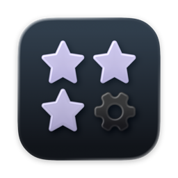
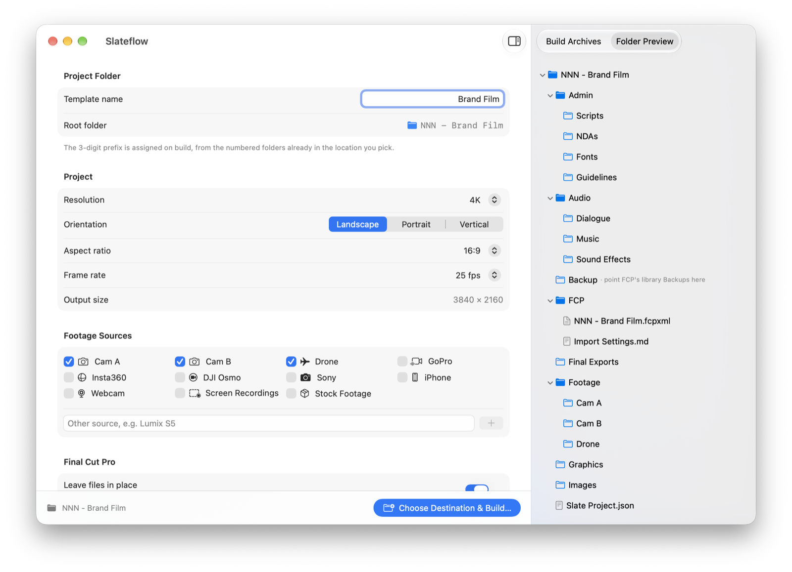
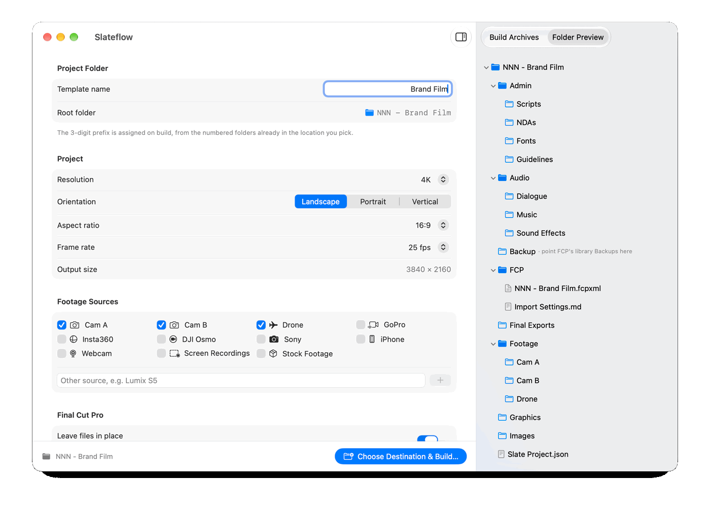

<p align="center">
  
</p>

<h1 align="center">Slateflow</h1>

<p align="center">
  Set up a Final Cut Pro project in one click: the folders, the <code>.fcpxml</code> and the library, the same way every time.
</p>

<p align="center">
  <a href="#install">Install</a> ·
  <a href="#what-it-does">Features</a> ·
  <a href="docs/PRIVACY.md">Privacy</a> ·
  <a href="CHANGELOG.md">Changelog</a> ·
  <a href="SUPPORT.md">Support</a>
</p>

<p align="center">
  <a href="https://github.com/PixelEtch/Slateflow/releases"></a>
  <a href="https://github.com/PixelEtch/Slateflow/actions/workflows/ci.yml"></a>
  
  <a href="LICENSE"></a>
</p>

<p align="center">
  <picture>
    <source media="(prefers-color-scheme: dark)" srcset="docs/assets/readme/main-dark.png">
    
  </picture>
</p>

## What it does

- **Numbered project folders.** `001 - Name`, `002 - Name`, …, always the next free number in the folder you pick.
- **The same structure every time.** Admin, Audio, Backup, FCP, Final Exports, Footage, Graphics and Images.
- **A folder per camera.** Turn on Cam A/B, Drone, GoPro, Insta360, DJI Osmo, Sony, iPhone, Webcam, Screen Recordings or Stock Footage, or type your own.
- **A ready Final Cut project.** The `.fcpxml` carries your resolution, aspect ratio, frame rate, roles, and Smart Collections that sort clips on import.
- **The library, created for you.** **Open in Final Cut Pro** has Final Cut create the library in the project's `FCP` folder and import the project. There's nothing to click in Final Cut, and the library always matches your installed version.
- **A record of every build.** `Slate Project.json` in each project, and **Build Archives** in the app to reuse past settings.

The **Folder Preview** updates as you change settings, so you see exactly what a build will create:

<p align="center">
  <picture>
    <source media="(prefers-color-scheme: dark)" srcset="docs/assets/readme/build-flow-dark.gif">
    
  </picture>
</p>

## Install

Download `Slateflow-<version>.dmg` from [Releases](https://github.com/PixelEtch/Slateflow/releases), open it and drag **Slateflow** onto **Applications**. It's signed and notarized by Apple, so it opens normally.

Updates arrive through **Slateflow > Check for Updates…**. Versions marked alpha or beta are test builds.

## Use it

1. Pick the format, footage sources, roles and Smart Collections.
2. Click **Choose Destination & Build…** and choose where the project goes.
3. Click **Open in Final Cut Pro**.

## What you need

- macOS 15 Sequoia or later, on Apple silicon or Intel.
- Final Cut Pro, to open the projects.

## Private by default

Everything stays on your Mac: no accounts, telemetry or cloud. The only network request is the update check. See [docs/PRIVACY.md](docs/PRIVACY.md).

## Uninstall

Move Slateflow from Applications to the Trash. To also remove its settings, Build Archives and log, delete `~/Library/Containers/com.ashifali.Slateflow`. Projects you built are not touched.

## Build it yourself

```bash
git clone https://github.com/PixelEtch/Slateflow.git
open Slateflow/Slateflow.xcodeproj
```

Run the **Slateflow** scheme in Xcode 26 or later. [CONTRIBUTING.md](CONTRIBUTING.md) covers the self-check and pull requests.

## Documentation

- [Troubleshooting](docs/TROUBLESHOOTING.md) · [Getting help](SUPPORT.md) · [Security](SECURITY.md)
- [Contributing](CONTRIBUTING.md) · [Code of Conduct](CODE_OF_CONDUCT.md)
- [Releasing](docs/RELEASING.md) · [Architecture decisions](docs/adr/README.md) · [Domain terms](CONTEXT.md)
- [Changelog](CHANGELOG.md)

## License

MIT. See [LICENSE](LICENSE). Slateflow includes [Sparkle](https://sparkle-project.org) for updates; its license ships in the app as `ThirdPartyNotices.txt`.

---

<p align="center"><sub>Made by Sk Ashifali Shaikh</sub></p>
