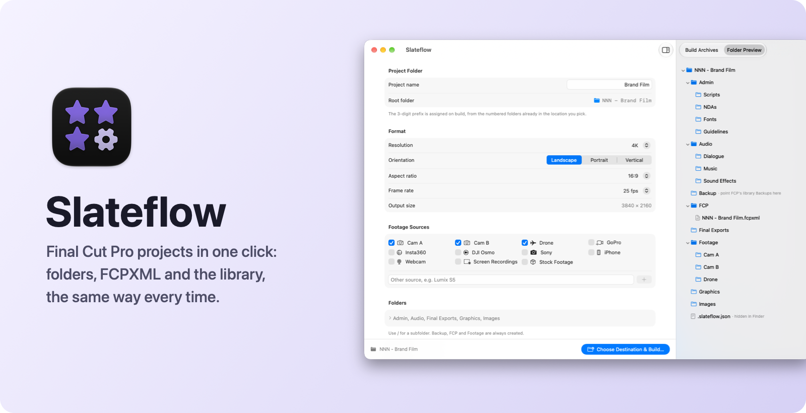
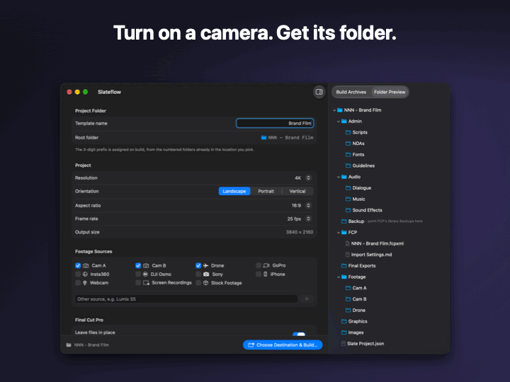

<h1 align="center">
  <picture>
    <source media="(prefers-color-scheme: dark)" srcset="docs/assets/readme/hero-dark.png">
    
  </picture>
</h1>

<p align="center">
  <a href="#install">Install</a> ·
  <a href="#what-it-does">Features</a> ·
  <a href="docs/PRIVACY.md">Privacy</a> ·
  <a href="CHANGELOG.md">Changelog</a> ·
  <a href="SUPPORT.md">Support</a>
</p>

<p align="center">
  <a href="https://github.com/PixelEtch/Slateflow/releases"></a>
  <a href="https://github.com/PixelEtch/Slateflow/actions/workflows/ci.yml"></a>
  
  <a href="LICENSE"></a>
</p>

## What it does

- **Numbered project folders.** `001 - Name`, `002 - Name`, …, always the next free number in the folder you pick.
- **The same structure every time.** Admin, Audio, Backup, FCP, Final Exports, Footage, Graphics and Images, or your own folders.
- **A folder per camera.** Cam A/B, Drone, GoPro, Insta360, DJI Osmo, Sony, iPhone, Webcam, Screen Recordings, Stock Footage, or your own.
- **A ready Final Cut project.** The `.fcpxml` carries your resolution, aspect ratio, frame rate, roles, and Smart Collections that sort clips on import.
- **The library, created for you.** Final Cut creates it in the project's `FCP` folder, in your installed version's format.
- **Reuse past settings.** **Build Archives** keeps every build's format and naming.

The **Folder Preview** shows what a build will create:

<p align="center">
  
</p>

## Install

Download the DMG from [Releases](https://github.com/PixelEtch/Slateflow/releases) and drag **Slateflow** onto **Applications**. It's signed and notarized by Apple. Updates come through **Slateflow > Check for Updates…**; alpha and beta versions are test builds.

## Final Cut settings

Final Cut can't take these from the project file, so set them yourself:

- **Once, in Final Cut Pro ▸ Settings ▸ Import:** turn on **Leave files in place**, and **Keywords: From folders** so camera folders fill their Smart Collections.
- **When a new library asks for storage locations:** set Backups to the project's `Backup` folder. Media and render files already stay inside the project.

## What you need

- macOS 15 Sequoia or later, on Apple silicon or Intel.
- Final Cut Pro.

## Private by default

Everything stays on your Mac: no accounts, telemetry or cloud. The only network request is the update check. See [docs/PRIVACY.md](docs/PRIVACY.md).

## Uninstall

Move Slateflow from Applications to the Trash. To also remove its settings, Build Archives and log, delete `~/Library/Containers/com.ashifali.Slateflow`. Projects you built are not touched.

## Build it yourself

```bash
git clone https://github.com/PixelEtch/Slateflow.git
open Slateflow/Slateflow.xcodeproj
```

Run the **Slateflow** scheme in Xcode 26 or later. [CONTRIBUTING.md](CONTRIBUTING.md) covers the self-check and pull requests.

## Documentation

- [Troubleshooting](docs/TROUBLESHOOTING.md) · [Getting help](SUPPORT.md) · [Security](SECURITY.md)
- [Contributing](CONTRIBUTING.md) · [Contributing with an AI agent](docs/AI-CONTRIBUTIONS.md) · [Code of Conduct](CODE_OF_CONDUCT.md)
- [Releasing](docs/RELEASING.md) · [Architecture decisions](docs/adr/README.md) · [Domain terms](CONTEXT.md)
- [Changelog](CHANGELOG.md)

## License

MIT. See [LICENSE](LICENSE). Slateflow includes [Sparkle](https://sparkle-project.org) for updates; its license ships in the app as `ThirdPartyNotices.txt`.

---

<p align="center"><sub>Made by Sk Ashifali Shaikh</sub></p>
